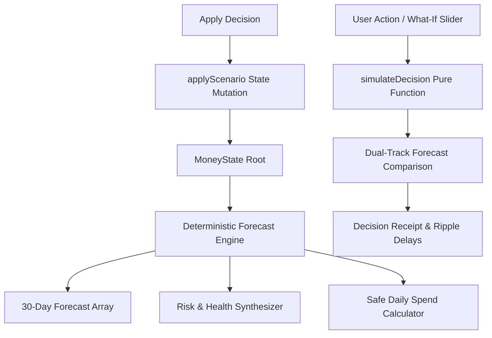

# Architecture & System Design Specification

This document details the software architecture, design patterns, mathematical invariants, and security model of **Broke But Functional**.

---

## 1. Architectural Principles

1. **Deterministic Financial Math**: Zero floating-point arithmetic. All monetary values are represented internally as integer paise (1 Rupee = 100 paise), avoiding IEEE 754 precision drift.
2. **Zero-Knowledge Client Boundary**: 100% of calculations, simulations, and state persistence execute client-side. Zero telemetry, zero analytics SDKs, and zero server-side data exfiltration.
3. **Causal Consequence Modeling**: Financial tracking is forward-looking. Changes to variables cascade through a pure, reactive dependency graph projecting 30 daily slices in sub-5ms latency.
4. **Resilient Local Persistence**: State is persisted to versioned browser storage (`bbf-state-v1`) safeguarded by runtime schema guards.
5. **Lightweight Native UI**: Zero heavyweight charting or styling runtimes. Custom SVG elements and hand-crafted CSS variables ensure sub-100ms First Contentful Paint (FCP) and 0 layout shifts.

---

## 2. Unidirectional Data Flow & Simulation Engine



### Deterministic State Cycle

1. **Source State**: `MoneyState` contains the user profile, ledger, scheduled commitments, subscriptions, savings goals, active risk liabilities, and decision log.
2. **Synchronous Projection**: `getForecast(state)` generates 30 day-by-day solvency records incorporating fixed outflows, daily discretionary spend, and planned income.
3. **Derived Intelligence**:
   - `getSafeToSpendToday(state)` computes the spendable pool left after commitments, buffer, savings, and shock reserves.
   - `getRiskScore(state, forecast)` evaluates proximity of projected danger days, negative deficits, and debt burdens.
   - `getHealthScore(state, forecast)` computes a multi-factor durability score.
   - `getRunwayAdvice(metrics, state)` produces context-aware coaching insights.

---

## 3. Directory & Component Structure

```text
broke-but-functional/
├── app/
│   ├── globals.css                # Handcrafted CSS design system & responsive rules
│   ├── layout.tsx                 # Application shell, responsive viewport & metadata
│   └── page.tsx                   # Product entry point
├── components/
│   ├── dashboard/
│   │   ├── BudgetRing.tsx         # Interactive SVG ₹10k Pool Allocation Ring
│   │   └── CategoryBreakdown.tsx  # Dynamic category spending distribution bars
│   ├── calendar/
│   │   └── SpendingMatrix.tsx     # 30-Day Spending & Solvency heatmap matrix
│   ├── what-if/
│   │   └── GoalImpactCard.tsx     # Savings goal ripple effect and delay feedback
│   ├── goals/
│   │   └── GoalLockboxSimulator.tsx # Interactive emergency cash lockbox slider
│   ├── health/
│   │   └── HealthAdvice.tsx       # Personalized runway intelligence & guidance
│   ├── money-app.tsx              # Main state conductor and tab router
│   ├── money-app.test.tsx         # Integration & accessibility tests
│   └── __tests__/
│       └── modular-components.test.tsx # Unit tests for modular UI components
├── lib/
│   ├── engine.ts                  # Pure deterministic math & simulation engine
│   ├── engine.test.ts             # Mathematical precision & edge-case test suite
│   ├── seed.ts                    # Day-8 realistic scenario state & presets
│   ├── types.ts                   # Strict TypeScript domain model & interfaces
│   ├── validation.ts              # Strict runtime schema validation guard
│   └── validation.test.ts         # Hostile payload & fuzzing test suite
├── .github/workflows/
│   └── ci.yml                     # Continuous integration pipeline
├── ARCHITECTURE.md                # System architecture specification
├── CONTRIBUTING.md                # Developer contribution guidelines
├── CHANGELOG.md                   # Semantic version history
└── README.md                      # Executive product documentation
```

---

## 4. Mathematical Specifications

### 4.1 Daily Spendable Pool

$$\text{Pool} = C_{\text{current}} - B_{\text{commitments}} - S_{\text{subscriptions}} - G_{\text{savings}} - R_{\text{shock}} - M_{\text{buffer}}$$

### 4.2 Safe Daily Spend Allowance

$$\text{Safe Daily Spend} = \max\left(0, \left\lfloor \frac{\text{Pool}}{\max(1, 30 - d_{\text{current}} + 1)} \right\rfloor\right)$$

### 4.3 Probability-Weighted Shock Reserve

$$R_{\text{shock}} = \min\left(150000, \sum_{i} (A_i \times P_i) \times 0.40\right)$$
Where $A_i$ is risk liability in paise, and $P_i \in [0, 1]$ is probability.

### 4.4 Financial Risk Index ($R \in [0, 100]$)

$$R = \text{clamp}\left(0, 100, W_{\text{danger}} + W_{\text{deficit}} + W_{\text{nearTerm}} + W_{\text{shock}} + W_{\text{subs}}\right)$$

---

## 5. Security & Trust Boundary

1. **Payload Size Guard**: In-flight JSON file imports cannot exceed 256 KB (`MAX_IMPORT_BYTES`).
2. **Cardinality Ceiling**: Collections (`ledger`, `commitments`, etc.) are capped at 500 items to defend against memory exhaustion attacks.
3. **Integer Range Clamping**: Numeric fields are bounded strictly to $[0, 10^9]$ paise ($₹10,000,000$).
4. **Unique ID Constraints**: Duplicate object IDs across entities trigger validation rejection.
5. **No Prototype Pollution**: Input objects are verified for plain record shapes without `__proto__` injection.
6. **Hardened HTTP Response Headers**:
   - `Content-Security-Policy`: Restricts scripts and framing.
   - `X-Frame-Options`: `DENY` against clickjacking.
   - `X-Content-Type-Options`: `nosniff`.

---

## 6. Accessibility & Performance Verification

- **Accessibility**: Full WCAG 2.1 AA compliance including semantic landmarks, keyboard focus management via `useModalDialog`, ARIA live feedback, and SVG charts with structured screen-reader alternatives.
- **Responsive Layout**: Fluid breakpoints supporting desktop ($>1024\text{px}$), tablet ($768\text{px}-1024\text{px}$), mobile landscape ($480\text{px}-767\text{px}$), and compact mobile ($<480\text{px}$) with $\ge 44\text{px}$ touch targets.
- **Verification Gate**: Validated through `npm run verify` (`format:check`, `lint`, `typecheck`, 30 unit & integration tests, and static Turbopack export).
