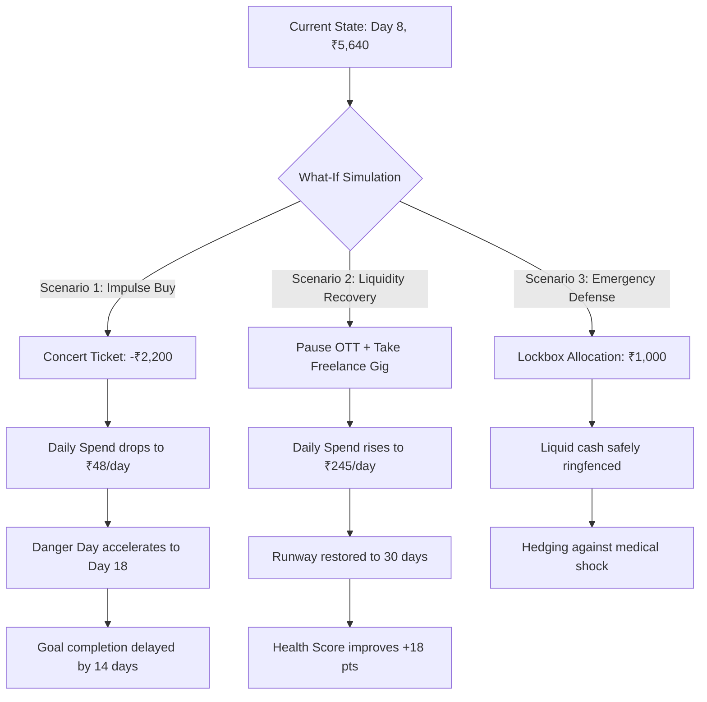

# Broke But Functional

### Deterministic Financial Consequence Engine & 30-Day Liquidity Simulator for Gen Z

[](https://broke-but-functional-seven.vercel.app/)
[](https://github.com/kulharshit21/broke-but-functional/actions)
[](https://nextjs.org/)
[](https://react.dev/)
[](https://www.typescriptlang.org/)
[](https://broke-but-functional-seven.vercel.app/)
[](./LICENSE)

---

## Executive Summary

**Broke But Functional** is an intelligent personal finance application engineered for Gen Z users managing a fixed **₹10,000 monthly budget** across a 30-day survival cycle.

Conventional personal finance tools are fundamentally retrospective: they catalogue where capital was spent only after it has already left the account. For individuals on tight liquidity budgets, retrospective reporting is inadequate—a single impulsive weekend purchase or unanticipated emergency expense can trigger insolvency weeks before the next income cycle.

**Broke But Functional** replaces post-mortem tracking with **forward-looking causal simulation**. By uniting balance, daily allowance, fixed commitments, recurring subscriptions, savings goals, and probabilistic shock reserves into a single deterministic calculation graph, the application enables users to **simulate any financial decision before committing to it**.

> _"Most personal finance trackers record your history. This engine forecasts your future."_

---

## Core Product Metrics at a Glance

| Metric                     | Architectural Definition                                                   | Practical User Impact                           |
| :------------------------- | :------------------------------------------------------------------------- | :---------------------------------------------- |
| **Current Balance**        | Verified liquid capital currently available in the primary account.        | Cash on hand right now.                         |
| **Committed Capital**      | Aggregate sum of mandatory bills, utilities, and scheduled outflows.       | Non-negotiable future obligations.              |
| **Protected Savings**      | Liquid funds locked into designated milestone goals.                       | Protected from casual spending.                 |
| **Safe Daily Spend**       | Residual spendable pool divided strictly by remaining cycle days.          | Max daily burn rate without breaking month-end. |
| **Danger Day**             | First projected date where forecasted liquid cash drops below buffer.      | Early warning beacon for insolvency.            |
| **Financial Risk Index**   | Deterministic 0–100 score weighted across runway, commitments, and shocks. | Quantified financial vulnerability.             |
| **Financial Health Score** | Multi-factor 0–100 index evaluating solvency, cushion, and discipline.     | Overall stability and recovery capacity.        |

---

## The Five Connected Core Experiences

The application unifies five specialized modules into an interconnected, responsive interface:

### 1. Today — The Command Cockpit

- **Real-Time Financial Vitals**: Immediate clarity on current cash, safe daily spending allowance, active runway, and month-end trajectory.
- **₹10,000 Pool Allocation Ring**: Interactive SVG donut visualization illustrating the exact distribution between Available Cash, Spent Funds, Committed Bills, and Goal Reserves.
- **Category Spending Dynamics**: Breakdown of completed disbursements across food, transit, utilities, lifestyle, and healthcare with percentage distribution tracks.
- **30-Day Trajectory Ribbon**: Dynamic day-by-day solvency sparkline indicating safe zones, tight periods, and projected danger days.

### 2. What-If Lab — Causal Consequence Simulation

- **Pre-Configured & Custom Scenarios**: Test discretionary splurges (concert tickets, sneaker drops, midnight delivery runs), liquidity boosts (freelance gigs), emergency shocks (medical treatments), or subscription cancellations.
- **Dual-Track Comparative Forecast**: Live visual comparison between the baseline financial path and the simulated scenario path over all 30 days.
- **Decision Receipts**: Quantified delta analysis detailing net cash variance, daily allowance adjustment, and new runway metrics before finalizing any transaction.
- **Goal Ripple Effect**: Real-time feedback calculating how discretionary spending directly delays target milestone completion and increases future daily savings requirements.

### 3. 30-Day Map — Solvency Calendar & Intensity Matrix

- **30-Day Spending & Solvency Matrix**: Heatmap-style 30-tile grid revealing historical spending intensity alongside forward-looking solvency status (Safe, Tight, Critical).
- **Date-Specific Event Scheduling**: Future-dated commitments and anticipated receivables can be scheduled on precise calendar days without distorting current liquid cash.
- **Daily Financial Inspection**: Drill down into any single day to inspect scheduled outflows, expected balances, and buffer adequacy.

### 4. Goals & Subscriptions — Commitment Architecture

- **Interactive Emergency Lockbox Simulator**: Slider-driven sandbox allowing users to test locking liquid cash into protected reserves, showing instant runway impact before locking funds.
- **Milestone Progress Tracking**: Real-time progress bars for designated goals (Emergency Fund, Tech Upgrades).
- **Subscription Intelligence**: Instant toggle to pause or activate recurring monthly services (OTT platforms, software passes), with immediate recalculation of safe daily spend and month-end cash.

### 5. Ledger & Trust Engine — Audit Trail & Portability

- **Immutable Transaction History**: Comprehensive journal of completed expenditures, scheduled commitments, and simulated moves.
- **Decision Undo & Reversion**: One-click rollback capability for applied simulations and logged expenses.
- **Encrypted Local Backup & Restoration**: Export and import full financial profiles as formatted JSON with strict runtime schema validation.

---

## Mathematical Specifications & Formulas

All currency operations use **integer arithmetic** (paise-level accuracy, scaled by 100) to eliminate IEEE 754 floating-point drift.

```
┌─────────────────────────────────────────────────────────────────────────────┐
│                       DETERMINISTIC CASHFLOW GRAPH                          │
│                                                                             │
│  Profile + Ledger + Commitments + Subscriptions + Goals + Shock Exposures   │
│                                      │                                      │
│                                      ▼                                      │
│                         Deterministic Forecast Engine                       │
│                                      │                                      │
│           ┌──────────────────────────┼──────────────────────────┐           │
│           ▼                          ▼                          ▼           │
│   Safe Daily Allowance         Risk & Health Index       30-Day Solvency    │
│   Formula: S(d)               Scoring: R(0-100), H(0-100) Matrix Trajectory │
│           │                          │                          │           │
│           └──────────────────────────┼──────────────────────────┘           │
│                                      │                                      │
│                                      ▼                                      │
│                         Every UI Surface Synchronized                       │
└─────────────────────────────────────────────────────────────────────────────┘
```

### 1. Spendable Daily Pool Formula

$$\text{Available Daily Pool} = C_{\text{current}} - B_{\text{commitments}} - S_{\text{subscriptions}} - G_{\text{savings}} - R_{\text{shock}} - M_{\text{buffer}}$$

Where:

- $C_{\text{current}}$: Liquid cash on hand in the primary spending account.
- $B_{\text{commitments}}$: Unpaid essential commitments due within the remaining cycle.
- $S_{\text{subscriptions}}$: Unpaid active recurring subscriptions due within the remaining cycle.
- $G_{\text{savings}}$: Unfunded portions of active savings targets.
- $R_{\text{shock}}$: Probability-weighted reserve for unexpected emergencies:
  $$R_{\text{shock}} = \min\left(1500, \sum (\text{Impact}_i \times \text{Probability}_i) \times 0.40\right)$$
- $M_{\text{buffer}}$: Mandatory liquid cushion (default: ₹500).

### 2. Safe Daily Allowance Formula

$$\text{Safe Daily Spend} = \max\left(0, \left\lfloor \frac{\text{Available Daily Pool}}{\max(1, 30 - \text{currentDay} + 1)} \right\rfloor\right)$$

### 3. Financial Risk Index ($R \in [0, 100]$)

The risk engine synthesizes five vulnerability vectors:
$$R = \text{clamp}\left(0, 100, W_{\text{danger}} + W_{\text{negative}} + W_{\text{commitments}} + W_{\text{shock}} + W_{\text{subscriptions}}\right)$$

- $W_{\text{danger}}$: Proximity and duration of projected danger days (up to 30 pts).
- $W_{\text{negative}}$: Projected month-end cash deficit severity (up to 35 pts).
- $W_{\text{commitments}}$: Unfunded commitment burden relative to current cash (up to 20 pts).
- $W_{\text{shock}}$: Unhedged exposure to high-probability emergencies (up to 15 pts).
- $W_{\text{subscriptions}}$: Recurring subscription overhead ratio (up to 10 pts).

### 4. Financial Health Score ($H \in [0, 100]$)

An index reflecting financial durability and recovery headroom:

- **Runway Adequacy** (25 pts): Days until balance breaches buffer / remaining days.
- **Cash Cushion Ratio** (25 pts): Liquid balance relative to total monthly fixed commitments.
- **Savings Discipline** (15 pts): Ratio of funded savings goals to target commitments.
- **Commitment Coverage** (15 pts): Solvency margin across fixed scheduled obligations.
- **Spending Discipline** (10 pts): Adherence to the calculated daily allowance.
- **Shock Readiness** (10 pts): Ability to absorb an unexpected ₹1,000 expense without insolvency.

### 5. Goal Delay Ripple Formula

When an optional discretionary expenditure $E$ is simulated, the engine computes the delay imparted onto an active goal:
$$\Delta_{\text{days}} = \left\lceil \frac{E}{\text{Safe Daily Spend}} \right\rceil$$
$$\text{Additional Daily Savings Required} = \frac{E}{\max(1, \text{Target Day} - \text{Current Day})}$$

---

## Realistic Baseline Scenario: Day 8 In-Flight Evaluation

To provide a real-world evaluation state rather than an empty form, the application initializes on **Day 8 of 30** with an in-flight financial history:

- **Original Budget**: ₹10,000
- **Liquid Cash Remaining**: ₹5,640
- **Completed Outflows (Days 1–7)**: Rent balance, initial grocery run, daily transit, utilities, chai, and an incoming freelance micro-payment.
- **Upcoming Outflows (Days 8–30)**: Mobile recharge (₹399), secondary grocery runs (₹1,400), recurring subscriptions (₹1,098 total: OTT, Spotify, Cloud), utilities, two savings goals (Emergency Buffer, Tech Upgrade), and three realistic shock liabilities.
- **Challenge**: Mid-month liquidity compression requires deliberate trade-offs to prevent breaking the ₹500 emergency buffer by Day 22.

---

## Interactive Decision Scenarios



### Scenario 1: The Impulse Purchase Shock

1. Select **"Buy concert ticket" (₹2,200)** in the What-If Lab.
2. The forecast engine separates the projected cash line into baseline (green) and scenario (blue) paths.
3. The **Decision Receipt** calculates an immediate drop in safe daily allowance from ₹138/day down to ₹48/day, pulls the first danger day forward to Day 18, and highlights an 11-day completion delay on the Emergency Fund goal.

### Scenario 2: Strategic Liquidity Recovery

1. Select **"Pause OTT subscription" (+₹499)** followed by **"Take freelance gig" (+₹2,500)**.
2. The dual-path graph illustrates immediate recovery: runway increases to the full 30 days, safe daily allowance climbs to ₹245/day, and the Financial Health Score jumps by +18 points.
3. Clicking **"Apply Decision"** executes the move into the live state and issues a permanent receipt.

### Scenario 3: Emergency Reserve Protection

1. Open the **Emergency Lockbox Simulator** in Goals & Subscriptions.
2. Move the interactive slider to simulate locking ₹1,000 into protected reserves.
3. Review how ringfencing capital shields against unexpected shocks while dynamically adjusting daily discretionary headroom.

---

## Security, Privacy & Reliability Architecture

```text
┌─────────────────────────────────────────────────────────────────────────────┐
│                       ZERO-KNOWLEDGE CLIENT BOUNDARY                        │
│                                                                             │
│   Incoming JSON / CSV Payload                                               │
│                │                                                            │
│                ▼                                                            │
│   ┌──────────────────────────────────────────────────────────────┐          │
│   │ Strict Schema Validation Guard (lib/validation.ts)            │          │
│   │ • Payload size ceiling: 256 KB                               │          │
│   │ • Array cardinality bounds (max 100 items per entity)        │          │
│   │ • Strict integer range checks (0 ≤ amount ≤ 1,000,000)       │          │
│   │ • Date consistency validation (1 ≤ day ≤ 30)                 │          │
│   │ • Unique ID constraint verification                          │          │
│   │ • Prototype pollution & script tag rejection                 │          │
│   └──────────────────────────────────────────────────────────────┘          │
│                │                                                            │
│     [Valid] ───┴─── [Invalid] ──> Rejected with actionable error            │
│        │                                                                    │
│        ▼                                                                    │
│   bbf-state-v1 (Local Storage Only - Zero Server Exfiltration)              │
└─────────────────────────────────────────────────────────────────────────────┘
```

- **Zero-Knowledge Architecture**: 100% of calculation, state management, and persistence occurs client-side in browser `localStorage`. No analytics trackers, external cookies, third-party fonts, or cloud telemetry are utilized.
- **Strict Input Validation Barrier**: All imported payloads pass through `lib/validation.ts`, enforcing strict numerical limits, date ranges, cardinality constraints, and rejecting hostile JSON structures.
- **Hardened HTTP Response Headers**:
  - `Content-Security-Policy`: Disallows untrusted script execution, restricts connections, and prohibits unsafe object loading.
  - `X-Frame-Options: DENY`: Prevents UI clickjacking attacks.
  - `X-Content-Type-Options: nosniff`: Guards against MIME type spoofing.
  - `Referrer-Policy: strict-origin-when-cross-origin`: Restricts metadata leakage.
- **Full WCAG 2.1 AA Accessibility Compliance**:
  - Semantic HTML markup (`<main>`, `<nav>`, `<section>`, `<article>`).
  - Accessible SVG charts with structured screen-reader tabular fallbacks.
  - Interactive dialogs featuring focus trapping, backdrop escape handling, and keyboard cycling.
  - High-contrast visual palette exceeding standard 4.5:1 text contrast ratios.

---

## Technical Stack & Architecture

```text
broke-but-functional/
├── app/
│   ├── globals.css             # Handcrafted CSS design system & micro-animations
│   ├── layout.tsx              # Application shell, metadata & security headers
│   └── page.tsx                # Client product entry point
├── components/
│   ├── money-app.tsx           # Unified component housing the 5 core experiences
│   └── money-app.test.tsx      # Component integration & accessibility test suite
├── lib/
│   ├── engine.ts               # Pure deterministic math, forecast & scoring engine
│   ├── engine.test.ts          # Mathematical precision & edge-case test suite
│   ├── seed.ts                 # Day-8 realistic scenario state & simulation presets
│   ├── types.ts                # Strict TypeScript domain interfaces & types
│   ├── validation.ts           # Schema validation guard for imported payloads
│   └── validation.test.ts      # Malicious import & schema fuzzing test suite
└── .github/workflows/
    └── ci.yml                  # Automated release pipeline (Lint, Typecheck, Test, Build)
```

- **Framework**: [Next.js 16.4](https://nextjs.org/) (App Router, Turbopack)
- **UI Runtime**: [React 19.1](https://react.dev/)
- **Type Safety**: [TypeScript 5.7](https://www.typescriptlang.org/) (Strict Mode)
- **Styling**: Handcrafted CSS design system utilizing CSS custom properties (Zero runtime styling overhead)
- **Visualizations**: Native, hand-coded SVG graphics (Zero charting library dependencies)
- **Testing**: [Vitest 5.0](https://vitest.dev/) with [Testing Library](https://testing-library.com/)

---

## Verification & Testing Quality Gate

Every commit is validated through an automated CI pipeline comprising **23 comprehensive test cases** and strict build checks:

```bash
npm run verify
```

The verification gate executes the following sequence:

1. **Prettier Format Check** (`npm run format:check`): Ensures code style uniformity.
2. **ESLint Strict Validation** (`npm run lint`): Enforces clean architecture with zero warnings or errors.
3. **TypeScript Compiler Check** (`npm run typecheck`): Strict type validation across all modules.
4. **Vitest Automated Test Suite** (`npm test`):
   - **Financial Engine Tests** (`engine.test.ts`):
     - Exact paise balance reconciliation across multiple transactions.
     - 30-day forecast generation and bounds verification.
     - Accurate detection of negative cash balances and danger days.
     - Subscription pause and reactivation mechanics.
     - Goal funding transfers and liquidity impact.
     - Emergency expense shock handling.
     - Risk and Health index bounded score guarantees ($[0, 100]$).
     - Category spending distribution calculations.
     - Goal ripple effect delay and daily required calculation accuracy.
   - **Security & Schema Tests** (`validation.test.ts`):
     - Successful parsing of compliant financial payloads.
     - Strict rejection of missing fields, malformed numbers, and invalid dates.
     - Rejection of oversized payloads (> 256 KB) and excessive collections.
     - Rejection of duplicate entity identifiers and prototype-polluting payloads.
   - **Component & Accessibility Tests** (`money-app.test.tsx`):
     - Core cockpit rendering and metric synchronization.
     - What-If Lab simulation workflow and consequence receipts.
     - Quick-entry dialog focus management, keyboard trap, and `Escape` dismissal.
     - Navigation between all five primary modules.
5. **Production Turbopack Build** (`npm run build`): Validates optimized static generation.

---

## Local Development Guide

### Prerequisites

- Node.js `>= 20.9.0`
- npm `>= 10.0.0`

### Installation & Execution

```bash
# 1. Clone repository
git clone https://github.com/kulharshit21/broke-but-functional.git
cd broke-but-functional

# 2. Install dependencies
npm install

# 3. Start local development server
npm run dev
```

Navigate to `http://localhost:3000` to interact with the application.

### Test Execution Commands

```bash
# Run full verification suite (lint, typecheck, test, build)
npm run verify

# Run unit and integration tests
npm test

# Run tests in interactive watch mode
npm run test:watch

# Format codebase
npm run format
```

---

## Design System & Aesthetics

**Paper Ledger Meets High-Signal Fintech.**

The visual design language avoids generic dashboard tropes in favor of an editorial, tactile aesthetic:

- **Surface Palette**: Warm paper tones (`#fbf8ef`, `#f4eedb`) paired with deep institutional green (`#0e2a1d`, `#163b2a`).
- **High-Signal Accents**: Acid lime (`#c9f04c`) and amber warning cues are reserved exclusively for critical thresholds, danger days, and action triggers.
- **Typography**: Classic serif headings for narrative framing juxtaposed with monospaced tabular numerals for all monetary values.
- **Tactile Depth**: Crisp editorial borders (`1.5px`) and hard offset shadows (`3px 3px 0px`) create a grounded, authentic physical document aesthetic.

---

## Deployment Architecture

The application is deployed to **Vercel** with zero-configuration edge hosting:

- **Production URL**: [https://broke-but-functional-seven.vercel.app/](https://broke-but-functional-seven.vercel.app/)
- **Continuous Deployment**: Every commit to the `main` branch automatically triggers GitHub Actions CI checks followed by an instant production deployment on Vercel.
- **Zero Secrets**: Pure static build architecture requiring zero environment variables, backend databases, or cloud secrets.

---

## License

This project is licensed under the [MIT License](./LICENSE).
